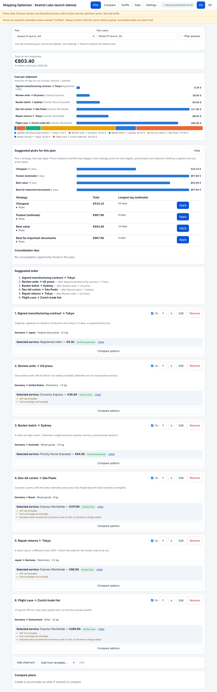
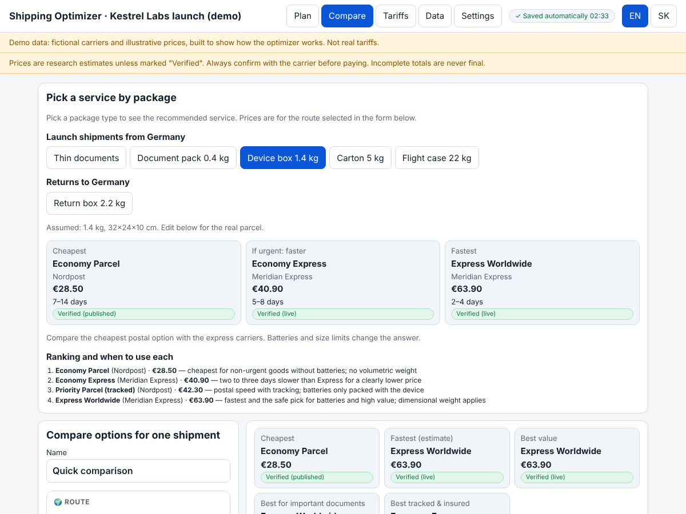
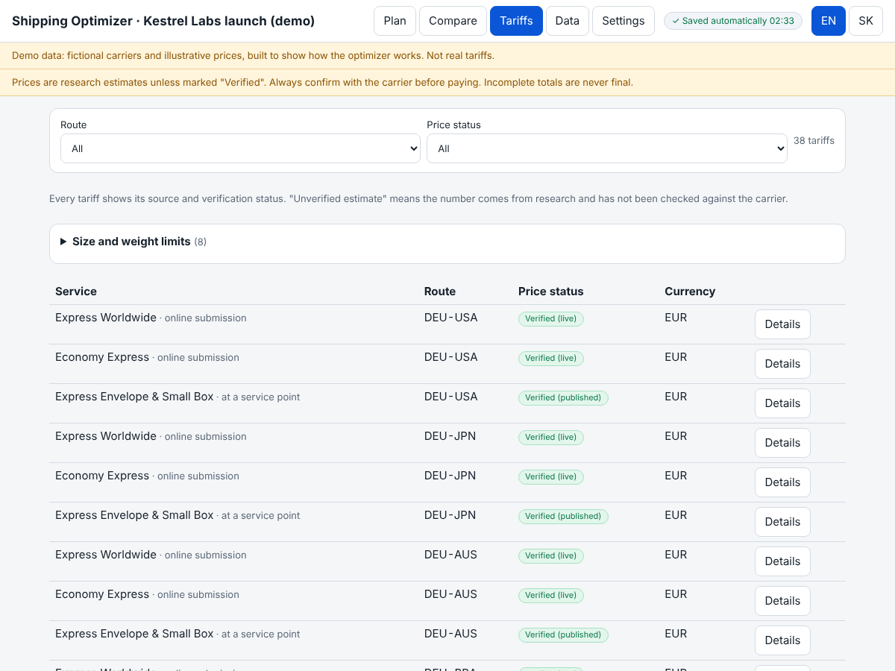
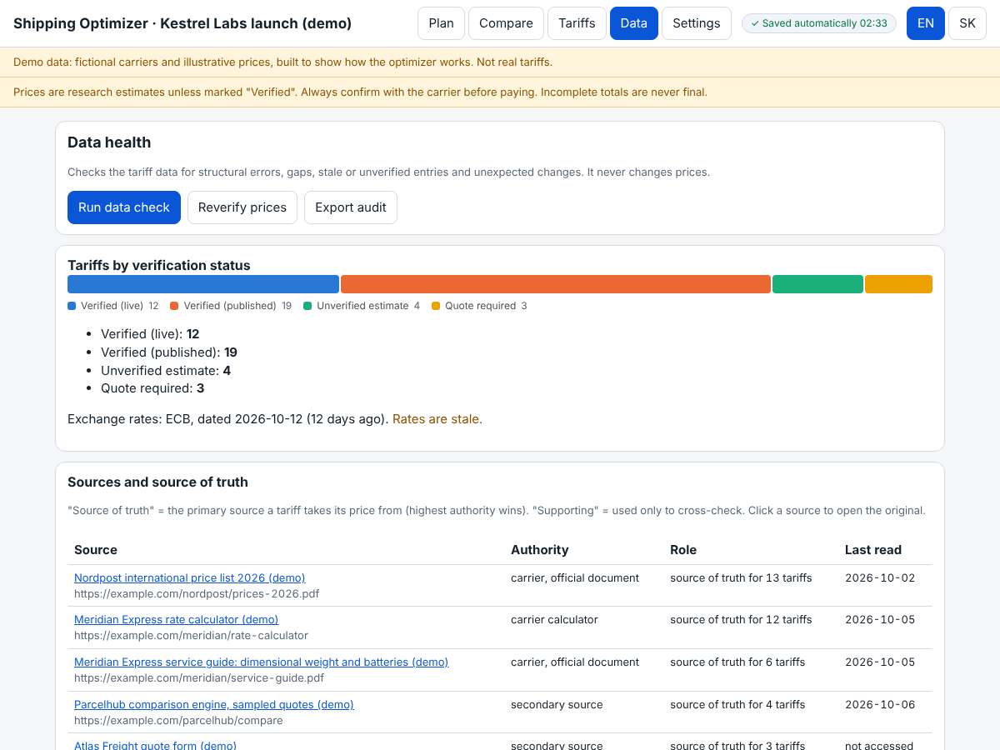

# Shipping Optimizer

**Plan a multi-parcel project, not just one parcel.** Compare carriers by price, size and weight limits, batteries, transit time and data quality, then see the cost of the whole plan with an honest total: *"at least €510"* until every leg is priced.

Multilingual (the demo ships English and German; languages are set per data profile) · React + TypeScript + Vite · runs entirely in the browser · MIT

**[Live demo →](https://aikitpete.github.io/shipping-optimizer/)** (sample carriers and illustrative prices)



## The demo story

The bundled sample profile walks through a typical product launch: a small hardware company in Leipzig shipping its first product, a pocket synthesizer, to customers, reviewers and partners worldwide. Each of the six shipments shows one thing the optimizer gets right:

| # | Shipment | What it demonstrates |
|---|---|---|
| 1 | Signed contract → **Tokyo**, 3-day deadline | Speed beats price: express envelope is the fastest pick, the registered letter only the cheapest |
| 2 | Review units with a **lithium-ion battery** → USA | Rule-based exclusion: the postal economy parcel prohibits batteries, so it disappears with a reason |
| 3 | Backer batch, 4.5 kg but bulky → **Sydney** | Dimensional weight (L×W×H ÷ 5000): the postal parcel is over 3× cheaper than express |
| 4 | Dev-kit carton → **São Paulo** | Thin data: estimates and quote-only freight keep the total *incomplete*, never silently summed |
| 5 | Warranty returns ← Tokyo | A different route (JPN→DEU) with its own services, chained after shipment 2 |
| 6 | 22 kg flight case → **Zurich** | Size and weight limits: over every postal limit, only the courier qualifies |

Open **Compare** to try the package guide (documents, a device box, a carton, a flight case), **Tariffs** for price-vs-weight curves, and **Data** for the data-health checks (stale prices, missing sources, fault-injection self-tests).

| Package guide | Tariffs | Data health |
|---|---|---|
|  |  |  |

> **The demo runs on sample data.** The carriers (Nordpost, Meridian Express, Parcelhub, Atlas Freight), prices and URLs are illustrative, built to be realistic in *shape*, so the repository can be public. They are not live tariffs and never an offer. The engine tags every price with a status and a primary source; nothing is "verified" without one.

## Bring your own data

The app is generic. All *data* comes from one **profile**: carriers, services, routes and countries, tariffs, limits, restrictions, transit times, sources, exchange rates, plan templates, package presets and the profile's own texts. This repository ships only the invented demo profile in `data/demo/`; plans are stored in your browser (IndexedDB) behind a small `PlanStore` interface. To plan with your own tariffs, see [docs/private-data.md](docs/private-data.md).

### Languages are data too
The language selector is built from `config.languages` of the active profile: the demo offers English and German, a private profile can offer any mix of the languages the app knows (`en`, `sk`, `de` today; add one in `src/i18n/languages.ts` plus a core dictionary). Country names live in the profile's `routes.json`, so a profile only needs names for the languages it offers.

### What a profile contains
```
manifest.json         which files belong to the profile
config.json           title, offered languages, default plan, quick-compare defaults, required routes, package-guide groups and presets
routes.json           countries (code, flag, one name per language) and routes
providers.json  services.json  tariff-tables/*.json  transit-times.json  restrictions.json
sources.json          every price points to one primary source (regulator > carrier > calculator > secondary > seed)
exchange-rates.json  templates.json  tariff-snapshot.json
i18n.<lang>.json     texts that belong to the data (plan names, notes, preset labels), one file per language
```
Everything is validated with Zod when loaded (`src/lib/data/schemas.ts`), and `npm run verify:data` runs the structural checks plus fault-injection self-tests that prove the checker really catches broken data.

## How the engine decides
- **Tariff types:** weight brackets, fixed packages (fit by sorted dimensions), sample points, quote-only. Native currency is authoritative; EUR = native / rate.
- **Eligibility:** a service is excluded only on an explicit "no" (weight, confirmed size limit, battery rule, docs-only). "Unconfirmed" is a warning, not a verdict.
- **Totals:** a grand total appears only when every active shipment is priced; otherwise "at least X" with the unpriced count.
- **Strategies:** cheapest, fastest, best value, best for important documents; each is a suggestion you apply, never automatic.
- **Plans:** shipments have dependencies, can be switched off per leg, and autosave with a visible "Saved" indicator. Export/import is JSON and never overwrites.

## Run it
```bash
npm install
npm run dev            # http://127.0.0.1:5173  (demo data)
npm test               # demo profile tests
npm run verify:data    # data checks; --verbose to list info items
npm run build          # type-check + static demo build in dist/
npm run update:rates   # refresh the profile's exchange rates from the ECB
```
Requires Node 20+.

## Project layout
```
data/demo/       the public showcase profile
scripts/         data verification, source register generator, ECB updater, private build
src/lib/data/    schemas, dataset builder, profile loader (browser fetch / Node fs)
src/lib/         pricing, eligibility and recommendations, plans, persistence (PlanStore)
src/components/  form, charts, recommendations, plan panels
src/pages/       Planner, Compare, Tariffs, Data health, Settings
tests/           vitest on the demo profile: story, storage backends, i18n, pricing, UI render
```

## License
[MIT](LICENSE). Carrier names in a private profile belong to their owners; this project is not affiliated with any carrier.
